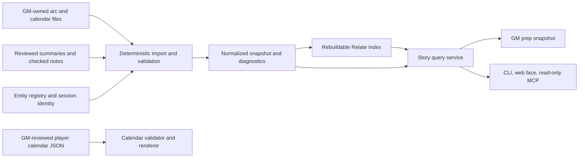

# Campaign story state: arcs, clocks, and calendars

**Date:** 2026-11-13

**Status:** proposed design; no implementation or campaign migration authorized by this document.

**Spec Kit input:** [CampaignStoryState_specify_input.md](CampaignStoryState_specify_input.md)

## 1. Decision and intended outcome

CampaignGenerator should provide the bookkeeping behind the GM-assistant's arcs, sandboxes, clocks, and in-fiction timeline. Skills should ask for GM judgment and compose prep; CampaignGenerator should resolve references, calculate dates, check state, and provide a reproducible view of what is in motion.

Use Relate as a **rebuildable graph index over campaign files**. The files remain authoritative. Deleting the index must never lose an arc, a ruling, a review decision, or an approved date. This follows constitution I; making the graph the campaign's sole store is outside this design.

Deliver the work in bounded features:

1. **Foundation:** read-only source import, graph queries, diagnostics, calendar calculations, a prep snapshot, and CLI/web/MCP access. The accompanying Spec Kit input describes this feature only.
2. **Reviewed changes:** versioned proposals and GM-approved edits to origin files, with stable authored IDs and recoverable file transactions. This needs its own specification and migration contract.
3. **Downstream convergence:** retire duplicated skill bookkeeping and reconcile thread/grounding contracts through explicit consumer migrations.

These are proposed engineering boundaries, not new GM rulings. In particular, the first feature does not amend the campaign's clock values, dates, knowledge, or document ownership.

## 2. Evidence and current ownership

Inspected CampaignGenerator at [`7e96bc5`](https://github.com/kostadis/CampaignGenerator/tree/7e96bc5e33bfd5cf00cbc7d9d035546ba4d88ab6) and the campaigns checkout at [`4682ca1cc`](https://github.com/kostadis/campaigns/tree/4682ca1cc787aa0d04732c36dec2a802c017753f). This is a dated baseline, not a claim that later checkouts have the same contents.

The GM-assistant is shared at `campaigns/gm-assistant/`, rather than nested under Phandalin. Its relevant contracts are:

| Owner | Current responsibility | CampaignGenerator responsibility proposed here |
|---|---|---|
| [`gm-arc`](https://github.com/kostadis/campaigns/blob/4682ca1cc787aa0d04732c36dec2a802c017753f/gm-assistant/skills/gm-arc/SKILL.md) | `new`, `record`, `mine`; distinguishes hopes from outcomes; requires GM approval | Parse and query the records; eventually validate and apply approved changes |
| [`gm-session-prep`](https://github.com/kostadis/campaigns/blob/4682ca1cc787aa0d04732c36dec2a802c017753f/gm-assistant/skills/gm-session-prep/SKILL.md) | ADVANCE questions, current cast, offstage clocks, proposed arc delta | Supply the dated prep snapshot and questions needing a ruling |
| [`gm-player-calendar`](https://github.com/kostadis/campaigns/blob/4682ca1cc787aa0d04732c36dec2a802c017753f/gm-assistant/skills/gm-player-calendar/SKILL.md) | GM-reviewed player wording and disclosure | Validate dates and render the reviewed player JSON |
| [`build_calendar.py`](https://github.com/kostadis/campaigns/blob/4682ca1cc787aa0d04732c36dec2a802c017753f/gm-assistant/skills/gm-player-calendar/build_calendar.py) | Harptos/numbered-day validation and HTML generation | Move the reusable calendar/renderer implementation into the package, with a coordinated skill handoff |
| `docs/arcs/*.md` and `sandboxes/*.md` | GM-owned origin files | Read as origin files; never regenerate them during foundation work |
| Villain strategy documents | Own villain knowledge ledgers | Link to them; never infer knowledge from a mention or move their ownership |

Phandalin's inspected records comprise three arcs, two sandboxes, thirteen global clock rows, six arc-local clock rows, and ten junction rows. Beats, rulings, mystery evidence, and calendar spans add further records. Most of their consistency rules currently live in skill instructions rather than executable checks.

### A concrete failure to preserve as a regression fixture

The [calendar's Leilon expectation](https://github.com/kostadis/campaigns/blob/4682ca1cc787aa0d04732c36dec2a802c017753f/Phandalin/docs/arcs/calendar.md#what-comes-next) retains a 17 Kythorn departure condition. The [arc clock](https://github.com/kostadis/campaigns/blob/4682ca1cc787aa0d04732c36dec2a802c017753f/Phandalin/docs/arcs/leilon-besieged.md#clocks) contains a later, 2026-11-05 ruling: arrive by the morning of 21 Kythorn; remaining in Neverwinter on the morning of the 20th is too late. That row also retains the older `Due 17 Kythorn` text.

The service must expose these assertions together with their sources. It must not decide that the largest date wins, equate departure and arrival conditions, or silently repair either origin. Arbitrary prose contradictions remain a GM judgment; deterministic checks can identify multiple date candidates and incompatible explicitly structured values.

### What already exists in CampaignGenerator

- [`event_spine.py`](../../pipelines/grounding/event_spine.py) builds ordered event rows with source lineage from ensemble facts.
- [`state_sections.py`](../../pipelines/summary_native/state_sections.py) builds `canon_events_timeline.md` from checked event notes. This is an ordered account of outcomes, not a fantasy-calendar engine.
- [`thread_attach.py`](../../pipelines/summary_native/thread_attach.py) and [`synth.py`](../../pipelines/summary_native/synth.py) still attach notes through the ratified thread registry.
- [`review/cards.py`](../../pipelines/summary_native/review/cards.py) provides versioned review packets and decision planning, currently coupled to supported review actions. A story-change adapter is new work, not an existing capability.
- [`EventOrdinalKG_proposal.md`](EventOrdinalKG_proposal.md) establishes why session identity, chapter labels, and event order must remain distinct. Its historical corpus measurements should not be treated as current state.

## 3. Architecture and authority

The index never becomes a source for reconstructing lost origin files. Normalized snapshots, diagnostics, and generated views are derived outputs too. They can be discarded and rebuilt from the declared inputs.

| Information | Authority | Important limit |
|---|---|---|
| Canonical entity identity and aliases | Existing entity registry and its established resolution chain | No second alias authority in the graph |
| Played outcomes | Reviewed session summaries; checked notes retain their existing support/custody requirements | A resolvable citation alone does not prove the claim it accompanies |
| GM intent, possible beats, and arc rulings | GM-owned arc files | Never feed their prose into outcome grounding |
| Offscreen clock state | Explicit GM ruling in its owner file | Elapsed time is not permission to tick it |
| In-fiction dates and their precision | GM-ruled calendar rows | Estimates stay estimates; undated stays undated |
| Villain knowledge | Its strategy document's sourced ledger | Mentioned, present, witnessed, and informed are different relations |
| Player calendar wording | Existing GM-reviewed player JSON | GM state is not automatically suitable for disclosure |
| Review verdicts | Review records on disk | No browser-only approvals |

## 4. Domain model

Use typed records independently of the graph binding. The graph adapter stores relationships; the domain layer defines their meaning and validates transitions. A generic Cypher write tool is not the GM workflow.

| Record | Meaning and relationships |
|---|---|
| Arc | Question, kind, driver, status, reconciled-through chapter; set in sandboxes; owns possible beats; links to strategy documents |
| Sandbox | Place, factions, party goals, affordances, and arcs it lists; no invented story question |
| Beat | Possible event, gate, and `pending / seen / dead` state; a seen state cites a played source |
| Affordance | Player action available in a sandbox; pushes zero or more explicitly named arcs; preserves offered/used/dead state |
| Clock | Obligation, event timer, progress track, or score; owner, raw state, last touched, optional timing expression and explicit numeric observations |
| Ruling | World or table-procedure decision, provenance, recorded date, reveal state, and explicit supersession if present |
| Evidence and knowledge entry | Cited observation, who saw or learned it when explicitly recorded, and whether evidence is available, held, or spent |
| Junction | Person/object/place through which arcs could meet; a possibility, not a scheduled convergence |
| Calendar span | One chapter or an explicitly grouped chapter range; start/end expressions, elapsed days, dating method, basis, approval and uncertainty |
| Expectation | Fixed date, relative delay, or conditional trigger tied to a clock/source; distinct from a played event |
| Thread observation | Unpromoted checked-note or ensemble suggestion, with source and latest supported status; no automatic arc attachment |

Every observation retains the campaign-relative origin path, source digest, section/row or line locator, original text, and any parsed provenance tag. Keep `origin_kind` (table, GM, module, overlay), `review_state`, `disclosure_state`, and `temporal_precision` separate. An approved GM secret is still secret; an approved possible beat is still unplayed.

### Identity

Arc and sandbox slugs already present in frontmatter are authored identifiers. Resolve entity links through the registry. Resolve structural links only by explicit IDs/slugs or exact, unambiguous references supported by the source format.

Legacy beat and clock rows often have no authored ID. The first importer gives such rows a deterministic **observation key** derived from relative path, section, exact content, and duplicate occurrence. This key is not enduring semantic identity: editing or moving the row changes it. Never use a database element ID, title similarity, or a line number as permanent identity. Preserve unresolved/ambiguous links as findings rather than silently dropping or merging them.

Durable row IDs belong to the reviewed-write feature's explicit migration. Until then, no approval is bound to an imported row key across edits.

## 5. Import and rebuild lifecycle

1. Resolve one campaign from the existing `config/config.yaml` contract. A proposed strict `config/story.yaml` declares its source paths, calendar system, and derived-output paths once. Paths resolve within that campaign; reject path/symlink escapes.
2. Read a bounded snapshot of declared sources. Record content hashes, importer/schema version, calendar-definition version, registry digest, and relevant session-map/checked-note manifests. Missing required input and deliberately absent optional input are different states.
3. Parse frontmatter, named sections, supported tables, and explicit citations without a model call. Preserve source bytes and unsupported text; report what could not be normalized. Markdown table parsing must handle escaped pipes and code spans.
4. Validate typed records and explicit references. Conflicting slugs or invalid required structure prevent publication of a usable generation. Partial coverage is reported and cannot masquerade as complete.
5. Build a new normalized snapshot and graph generation under a staging directory. Apply graph constraints and validate record/edge counts and reference coverage.
6. Recheck source fingerprints before promoting the generation. If inputs changed, refuse promotion and leave the previous generation intact.
7. Atomically replace a small generation manifest only after both artifacts are complete. Queries read only the published generation. Interrupted staging builds are disposable.

The graph and source files are not a distributed transaction. Foundation avoids that problem by never writing the sources. Graph publication uses a generation boundary, not an assertion that multiple filesystem replacements are inherently atomic.

An explicit rebuild may write declared derived outputs. Read-only queries and validation do not write origins or silently rebuild the cache. Missing/stale indexes produce an actionable rebuild status; an explicitly requested diagnostic view may show stale data only with a visible stale marker and source manifest.

## 6. Time is three separate axes

Keep these fields distinct:

- **Played order:** stable session identity, the authored session/chapter mapping, scene order, and source order. A chapter label or recording date alone is not a universal key.
- **In-fiction time:** a setting calendar date, interval, relative expression, or unknown value.
- **Recorded/reviewed time:** when the GM made or approved a ruling. A later edit date is not automatically in-fiction time or semantic supersession.

### Calendar adapter

Provide deterministic adapters for Harptos, Greyhawk's Common Year, and numbered days. Definitions declare month/festival ordering and leap rules. Ship verified boundary fixtures; source the Greyhawk definition from the campaign's ruled definition rather than guessing at month names or festival weeks.

Arithmetic uses a calendar ID plus an ordinal day, with setting-formatted labels at the boundary. Never coerce fantasy dates into Gregorian `datetime.date`. Preserve intervals, unknown years, grouped chapter spans, dating method (`stated`, `counted`, `travel`, `unknown`), and the campaign's approved uncertainty range. Contextual shorthand such as `16 Kythorn` may inherit a year only through a documented, unambiguous source rule; otherwise it remains unresolved.

Relative expectations retain their expression and anchor. An unruled anchor yields an unresolved expectation. When a later feature changes an approved anchor, it must show every affected date and reopen affected approvals; it cannot quietly propagate new approved dates.

The source template and Phandalin's actual calendar use different descriptions of `Days` (since the previous row versus end minus start). Import the explicit dates and declared day count, expose any mismatch, and distinguish a gap between spans from a span's duration. Do not manufacture days inside a grouped chapter range or reconcile the discrepancy automatically.

For an uncertain today interval `[earliest, latest]` and an exact due day `D`, report `future` when `latest < D`, `definitely overdue` when `earliest > D`, and `within current date range` otherwise. Keep exact-day due status separate when today is exact. These are calendar comparisons, not permissions to fire a clock or confirm an outcome.

## 7. Queries, diagnostics, and views

The first feature supplies these deterministic queries:

- Arcs running in a selected sandbox, their explicit links, pending/dead/seen beats, and source coverage.
- All clocks relevant to selected arcs/place, their last touch and due/uncertain/unresolved timing, without numeric or narrative inference.
- Junctions shared by selected arcs, with the source's possibility text.
- Calendar spans, today, elapsed intervals, and upcoming expectations.
- A GM prep snapshot containing the selected sandbox/arcs, clocks, unresolved decisions, source links, and coverage/freshness status.
- Thread observations matching explicit entity IDs/approved aliases or literal search terms, clearly labeled as suggestions. Group by exact source title only; semantic deduplication remains future work.

Diagnostics include broken/ambiguous references; duplicate authored IDs; unsupported state/date syntax; missing provenance; stale reconciliations; missing/ambiguous session mappings; numeric tracks with unknown baselines; and timing assertions that require a GM ruling. Use the existing 2/4/6 chapter clock/arc/thread thresholds as declared defaults, with one shared config definition. A staleness flag never changes status or deletes a record.

Clock last-touched chapter and arc `as_of` describe different things. A record reconciled without a state change must not become a fictitious clock tick. Default chapter progress comes from the authoritative played-session mapping, not lexicographic directory order.

Preserve raw numeric states. In particular, `total unknown; +2` does not mean total 2, and a pending `+1` does not increment the score. `dead` beats are excluded from offered pending beats but remain visible in history. An empty `Seen by the party` section raises a payoff warning; the software does not decide narrative payoff eligibility.

### Player view

The foundation renderer consumes the existing GM-reviewed player-calendar JSON and the shared calendar adapter. It does not summarize GM state or infer that a revealed ruling may be published. Keep `artifact_url` and private review notes out of the rendered payload as the existing script does. This feature writes a local artifact only; hosting, sharing, and republishing require the existing explicitly authorized workflow.

## 8. Package and interaction boundaries

Suggested names, to be finalized in planning:

- `campaignlib/story/`: typed records, config, calendar adapters, parser contracts, validation, and the query interface.
- `pipelines/story/`: the installed `story` command, import orchestration, and deterministic rendering.
- `server/routers/story.py`: thin subprocess invocations through the existing runner.
- A minimal web face for every delivered CLI capability; selection, output paths, rebuild options, filters, and diagnostic results remain reachable.
- Read-only MCP tools wrapping the same campaign-bound query contract. Return source locations and freshness/coverage metadata, not just a prose answer.

Example operation family: `story index build|status`, `story check`, `story list arcs|clocks|junctions`, `story calendar show|compare|render-player`, `story prep`, and `story threads find`. These are proposed names, not existing commands. Reuse established `--config`, `--campaign-dir`, `--json`, and output-selection conventions where applicable; do not create another option dialect.

Batch prep/export actions require an explicit selection. Read-only discovery may list available records; an empty action selection must not expand into a whole-campaign export. UI, CLI, and MCP report the same normalized values and refusals.

## 9. Relate evaluation and operational limits

[Relate](https://github.com/relatedb/relate) is an embedded property graph with an in-process Python binding. Parameterized Cypher, constraints, and transactions fit the relationship queries above. It does not provide the campaign's approval policy, calendar rules, or evidence semantics.

On 2026-11-13, a scratch probe using released `relate-db==1.0.1` imported the inspected records into 34 nodes and 46 relationships. It passed parameter binding, repeat `MERGE` import without duplication, uniqueness refusal, multi-statement rollback, close/reopen persistence, read-only queries/write refusal, second writable-open refusal, and foreign-thread connection refusal. Eight junctions linked multiple arcs. The probe imported structural records and raw clock state; it did not normalize the complete calendar, beat, ruling, or knowledge corpus.

The probe lived in `/tmp/cg-relate-evaluation/`; temporary files are not a shipped dependency or enduring test fixture. Implementation must reproduce these checks in sanitized committed fixtures. No crash recovery, performance, cross-process contention, or complete migration claim follows from this experiment.

The [v1.0.1 Python contract](https://github.com/relatedb/relate/blob/v1.0.1/docs/api/python/spec.md) makes connections thread-affine, and a second writable open of a store is refused. [Storage documentation](https://github.com/relatedb/relate/blob/v1.0.1/docs/guides/storage-engine.md) describes single-level transactions and read-only opens; [limitations](https://github.com/relatedb/relate/blob/v1.0.1/docs/limitations.md) describe the in-memory working set and single-process scope.

The foundation therefore builds with one owning process/thread, closes its writer, and publishes an immutable generation. Separate CLI/web/MCP readers open that generation read-only in their own owning thread. Retain old generations while readers can still reference them; cleanup cannot race a live reader. Do not share one Python connection between FastAPI request threads. A persistent database daemon is unnecessary for this stage.

Planning must pin and verify a supported Relate release, wheel availability across CampaignGenerator's supported Python/platform matrix, installation cost, and any required dependency extra. Keep it behind one adapter. If package compatibility or recoverability fails, report the blocker explicitly; do not silently fall back to a different backend. SQLite remains a comparison option, not a second implementation to build in parallel. These tiny record counts justify no performance claim for either engine.

## 10. Reviewed changes: required follow-up contract

This section defines the destination, not foundation acceptance criteria.

1. A proposal names its operation (`record played outcome`, `advance clock by GM ruling`, `new arc`, `change calendar anchor`, or explicit thread promotion), exact source scope, before/after values, evidence, and expected origin hashes/revisions.
2. The GM reviews a versioned packet. Unmarked stays undecided; Discuss defers; only explicit approvals permit writes. Adapt the existing review contract instead of translating page verdicts by hand.
3. Planning validates source ownership, stable authored IDs, transition rules, evidence, and all date dependencies. A changed source or approval scope invalidates the plan.
4. Applying a confirmed plan acquires the campaign authority lock, rechecks the plan, and journals all origin-file and audit-record changes as one recoverable unit. A stale dependency prevents any write. Reapplying the same approved operation is a no-op.
5. Only after the origin transaction commits does the service invalidate/rebuild derived state. A graph failure leaves committed source truth recoverable and marks the index stale.

Do not assume a Relate transaction also commits Markdown files, or that the existing review card implementation makes a many-batch source update atomic. [Issue #657](https://github.com/kostadis/CampaignGenerator/issues/657) records its current partial-save boundary.

Existing origin ownership remains explicit: a villain ledger edit targets its strategy document; an arc edit cannot write a dossier authored file whose contract prohibits tool writes. Stable-ID/schema changes require a separate one-shot migration command, preview, operator instructions, and verification. Runtime readers refuse an unmigrated layout with the migration command; they do not probe both old and new locations.

## 11. Existing features and conflicts to reconcile

- The GM-assistant's [arc decision record](https://github.com/kostadis/campaigns/blob/4682ca1cc787aa0d04732c36dec2a802c017753f/gm-assistant/working/arc-tracking/DECISIONS.md) retires thread ratification, while current `summary_native synth` still requires registry attachment. Foundation reads thread observations as suggestions and leaves that consumer unchanged. A later feature must specify the outcome-to-arc bridge, review and migration before retiring the registry; arc prose must never become grounding evidence.
- [#534](https://github.com/kostadis/CampaignGenerator/issues/534) and [#535](https://github.com/kostadis/CampaignGenerator/issues/535) cover quest seeding and a graph editor. This service can later index their files; it does not choose quest identity or replace their editing workflow.
- [#537](https://github.com/kostadis/CampaignGenerator/issues/537) uses “character arc” for pinned retrospective milestones. This design's **story arc** is the GM's prospective question and possible beats. Do not merge those meanings or decide where pinned character history belongs.
- [campaigns#510](https://github.com/kostadis/campaigns/issues/510) was completed by introducing campaign calendars. This proposal brings the reusable tooling into CampaignGenerator; it does not reopen that completed campaign-format task.
- Skill changes live in the campaigns repository. A coordinated follow-up must replace duplicate arithmetic/rendering with calls into the installed package, document the required package version, and preserve GM checkpoints. Editing those skills is not implicitly part of a CampaignGenerator-only implementation.

## 12. Delivery and validation

| Slice | Deliverable | Exit condition |
|---|---|---|
| A: foundation (accompanying Spec Kit input) | Source adapters, snapshot/index lifecycle, diagnostics, calendars, prep queries, player-calendar rendering, CLI/web/MCP faces | Rebuildable, deterministic, zero model calls, zero origin writes; all supported legacy gaps are visible |
| B: reviewed edits (separate specification) | Stable-ID migration, proposal packets, domain transitions, atomic file application, audit and replay protection | Approved operations survive crashes/retries; stale approval never writes |
| C: consumers (separate specification) | Skill shims, thread/grounding migration, broader state reuse | One owner per fact and no origin/consumer contradiction |

Foundation tests should exercise behavior rather than mirror parser code:

- Sanitized fixtures matching the inspected three-arc/two-sandbox/19-clock/10-junction shape; preserve dangling links and unsupported rows in coverage reports.
- Leilon-style mixed timing assertions shown together, without selecting or rewriting a deadline.
- Harptos festival/year boundaries and Shieldmeet; confirmed Greyhawk festival-week boundaries; numbered-day arithmetic; uncertain/undated/relative/grouped spans.
- Unknown score baseline plus an explicit increment, dead beats, a pending unplayed beat, unpromoted threads, and a GM-only ruling absent from player output.
- Repeated rebuilds with equivalent normalized records; changed origins during import; interrupted staging; corrupt/missing cache; readers on an old generation; no origin mutation.
- Exact/ambiguous identity, duplicate slugs, source path escapes, and session/chapter-map disagreement.
- Identical query values and explicit selection across CLI/web/MCP, including every newly introduced option's UI reachability.
- Packaged calendar templates and dependencies present in an installed wheel, not dependent on a campaigns checkout.

Use the repository's relevant config, no-LLM, provenance/custody, route, frontend, and wheel tests. Do not benchmark the whole narration pipeline for this feature. Foundation success is a dependable shared read model; approved mutation is explicitly reserved for slice B.
